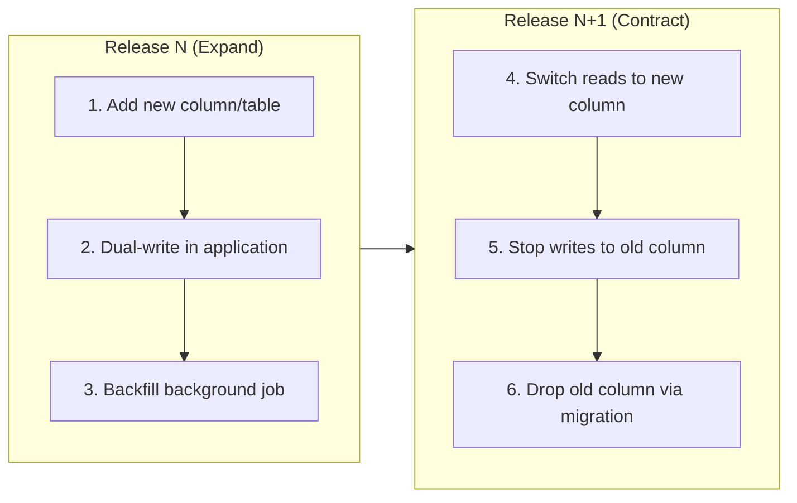

# Database Migration Discipline & Production Data-Integrity Standard

This document defines the mandatory policies, environment configurations, CI guardrails, and operational runbooks for database schema changes in `mana-community-service`.

---

## 🛡️ Core Principles

1. **Flyway is the Sole Authority:** All schema alterations across production, staging, and development must be performed strictly via versioned Flyway migration scripts.
2. **Strict Zero-Mutation by ORM:** Hibernate `ddl-auto` is strictly set to `validate` in production and development. Under no circumstance may Hibernate mutate database tables, add columns, or alter constraints automatically.
3. **Deterministic & Sequential:** In production, migrations must be executed sequentially (`out-of-order: false`). Cheating migration history by altering checksums or dropping history tables is strictly prohibited.
4. **Tenant-Aware Isolation:** Every table storing society/community data must enforce tenant segmentation via `community_id` foreign keys and indexes.

---

## ⚙️ Environment Migration Matrix

| Environment | Spring Profile | Flyway Enabled | Flyway Strategy | Hibernate `ddl-auto` | Clean Allowed |
|---|---|---|---|---|---|
| **Production** | `prod` | `true` | Automated forward migrations only; `out-of-order: false`, `validate-on-migrate: true` | `validate` (Fail-fast on schema mismatch; zero mutations) | ❌ Prohibited (`clean-disabled: true`) |
| **Development** | `dev` | `true` | Automated forward migrations; `out-of-order: false`, `validate-on-migrate: true` | `validate` (Fail-fast on entity drift) | ❌ Prohibited (`clean-disabled: true`) |
| **Local Dev** | `local` | `true` | Automated migrations against local PostgreSQL (`baseline-on-migrate: true`) | `validate` | ❌ Prohibited (`clean-disabled: true`) |
| **Unit Tests** | `test` | `false` | Disabled; H2 in-memory DB slice tests | `create-drop` | N/A |

---

## 🚫 Prohibited Anti-Patterns

1. **Never use `spring.jpa.hibernate.ddl-auto: update` in production:**
   - Causes race conditions with Flyway migrations.
   - Silently alters columns, removes constraints, or creates nullable variants that break zero-downtime deployments.
2. **Never hardcode `baselineVersion` or `outOfOrder(true)`:**
   - Skips critical migrations on fresh environments or executes migrations non-deterministically.
   - All settings must be bound to `spring.flyway.*` properties via `FlywayProperties`.
3. **Never run `flyway.repair()` automatically on application startup:**
   - Automatic repair masks corrupted, half-applied, or tampered migrations without administrative review.
   - Repair must only be executed through explicit operational runbooks during scheduled maintenance windows (`app.flyway.repair-on-startup=true`).
4. **Never drop `flyway_schema_history` table:**
   - Dropping the schema history table destroys the audit trail of applied changes and causes duplicate execution errors.

---

## 🔍 CI Guardrails & Automated Testing

The build and CI pipeline enforces migration discipline via [`FlywayMigrationValidationTest`](file:///D:/Application/applications/mana%20community/mana-community-service/src/test/java/com/manacommunity/api/config/FlywayMigrationValidationTest.java):

```bash
./mvnw test -Dtest=FlywayMigrationValidationTest
```

### What CI Verifies:
1. **Naming Standard:** All migration scripts adhere to `V<version>__<description>.sql` or `R__<description>.sql`.
2. **Version Uniqueness:** Zero duplicate versions across all 329+ migrations (including sub-versions like `V82_1`).
3. **No Destructive Keywords:** Absence of raw `DROP DATABASE` or unconstrained schema drops.
4. **Production Profile Discipline:** Asserts `application-prod.yaml` sets `ddl-auto: validate`, `clean-disabled: true`, and `out-of-order: false`.

---

## 📋 Tenant-Aware Schema Change Checklist

Because `mana-community-service` is a multi-community platform, schema changes must preserve tenant boundaries.

Before submitting any migration creating or altering tables:

- [ ] **Tenant Key:** Does the table contain a `community_id BIGINT NOT NULL` column (unless it is a global master/lookup table)?
- [ ] **Foreign Key:** Is there an explicit foreign key referencing `community(id)`?
  ```sql
  CONSTRAINT fk_table_community FOREIGN KEY (community_id) REFERENCES community(id) ON DELETE CASCADE
  ```
- [ ] **Tenant Index:** Is there an index on `community_id` for performant tenant query filtering?
  ```sql
  CREATE INDEX IF NOT EXISTS idx_table_community ON table_name(community_id);
  ```
- [ ] **Soft Deletes & Auditing:** Are standard audit columns (`created_at`, `updated_at`, `is_active`) included?
- [ ] **Idempotency:** Are `IF NOT EXISTS` or defensive guards used where applicable?

---

## 🔄 Destructive Migrations: Expand/Contract & Backup Runbook

Destructive operations (dropping columns, changing data types, dropping tables) require the **Expand/Contract Pattern** spanning at least two deployment cycles.



### Pre-Migration Backup Protocol (Production):
Before applying any migration involving schema restructuring or bulk data backfills:

1. **Create full database snapshot:**
   ```bash
   pg_dump -h $DB_HOST -U $DB_USERNAME -d manacommunity -F c -b -v -f "/var/backups/mana_pre_v$(date +%Y%m%d_%H%M%S).dump"
   ```
2. **Test restore on staging:**
   Verify the snapshot restores cleanly in the staging environment before deploying the migration to production:
   ```bash
   pg_restore -h $STAGING_HOST -U $STAGING_USER -d manacommunity_staging --clean --if-exists "/var/backups/mana_pre_..."
   ```

---

## 📝 Release Notes Compatibility & Rollback Strategy

Every release that includes database migrations must provide a compatibility statement in the release notes:

### Release Notes Migration Template:
```markdown
### Database Migrations in this Release
- **Migration Script(s):** `V330__add_custom_feature_table.sql`
- **Backwards Compatible:** YES (New table; existing endpoints unaffected)
- **Deployment Order:** Deploy database migration BEFORE or WITH service JAR.
- **Rollback Strategy:**
  - If service rollback required: Old JAR is compatible with new table (no breaking changes).
  - Clean rollback script (run manually only if release is aborted):
    `DROP TABLE IF EXISTS manacommunity.custom_feature_table;`
    `DELETE FROM manacommunity.flyway_schema_history WHERE version = '330';`
```
