# AWS SQS Event Catalog, Architecture & Payload Specification
**Mana Community Service Platform**  
*Document Version: 1.0.0 | Last Updated: 2026-11-25*

---

## 1. Executive Overview & Purpose

AWS Simple Queue Service (SQS) is integrated into `mana-community-service` to decouple critical transactional workflows from heavy, third-party, or slow operations:
- **Zero-Block Database Transactions**: Endpoints return `200 OK` or `202 Accepted` instantly. Heavy operations (Expo Push notifications, SMS gateways, external HTML scrapers, heavy CSV report generations) execute in the background.
- **Transactional Safety (`publishAfterCommit`)**: SQS messages are published strictly **after** the local PostgreSQL database transaction commits. This guarantees consumers never read uncommitted rows.
- **Seamless Local & Cloud Portability**: Runs with cloud AWS SQS, local Docker LocalStack, or native zero-docker ElasticMQ on `http://localhost:4566`.
- **Fail-Safe In-Process Fallback**: When SQS is disabled (`app.sqs.enabled: false`) or unreachable, `SqsMessagePublisher` executes in-process fallbacks on thread pools without dropping events or crashing.

---

## 2. Canonical Message Envelope (`SqsEventEnvelope`)

Every single message pushed through `SqsMessagePublisher` wraps the domain payload inside a standardized envelope:

```json
{
  "eventId": "a5e840d2-9721-4f06-bb27-7201c13d80a1",
  "eventType": "MATCH_RESULT_FEED_POST",
  "queueName": "mana-sports-events",
  "timestamp": "2026-11-25T15:10:00Z",
  "payloadJson": "{\"matchId\": 102}"
}
```

### Envelope Fields Specification

| Field | Type | Description | Mandatory |
| :--- | :--- | :--- | :--- |
| `eventId` | `String` (UUID v4) | Unique identifier for deduplication, logging, and distributed tracing. | Yes |
| `eventType` | `String` | Semantic event name matching the domain operation. | Yes |
| `queueName` | `String` | Target queue name (e.g. `mana-sports-events`). | Yes |
| `timestamp` | `Instant` (ISO-8601 UTC) | Time the event was published. | Yes |
| `payloadJson` | `String` (JSON) | Stringified JSON object containing domain-specific fields. | Yes |

---

## 3. Queue Registry & Event Catalog

The platform currently defines **12 production domain queues**. All queue names are configurable under `app.sqs.queues.*` in `application.yaml` / `application-local.yaml`.

```mermaid
flowchart TD
    subgraph Producers ["Event Producers (Controllers & Services)"]
        SmsSvc["SmsServiceImpl"]
        NotifHnd["NotificationEventsSqsHandler"]
        SportsMatch["SportsAdminMatchController"]
        KnockoutCtl["SportsTournamentSchedulerController"]
        AuctionSvc["SportsAuctionServiceImpl / EventAuctionServiceImpl"]
        IoTMesh["IoTMeshService"]
        MobilitySvc["MobilityServiceImpl"]
        GroupOrderSvc["GroupOrderService"]
        CricHeroesCtl["SportsCricHeroesController"]
        ReportCtl["EventReportController"]
        RegEmailSvc["RegistrationEmailService"]
        PaySvc["CashfreePaymentService / RazorpayPaymentService"]
        HealthSvc["HealthGuardService / EscalationScheduler"]
    end

    subgraph Queues ["AWS SQS Queues"]
        Q1[("mana-sms-dispatch")]
        Q2[("mana-notification-events")]
        Q3[("mana-sports-events")]
        Q4[("mana-auction-notifications")]
        Q5[("mana-iot-alerts")]
        Q6[("mana-mobility-events")]
        Q7[("mana-grouporder-notifications")]
        Q8[("mana-external-sync")]
        Q9[("mana-report-jobs")]
        Q10[("mana-email-dispatch")]
        Q11[("mana-payment-events")]
        Q12[("mana-emergency-sos")]
    end

    subgraph Consumers ["Consumers (SqsMessageHandler)"]
        C1["SmsDispatchSqsHandler"]
        C2["NotificationEventsSqsHandler"]
        C3["SportsEventsSqsHandler"]
        C4["AuctionNotificationSqsHandler"]
        C5["IoTAlertSqsHandler"]
        C6["MobilityEventsSqsHandler"]
        C7["GroupOrderNotificationSqsHandler"]
        C8["ExternalSyncSqsHandler"]
        C9["ReportJobSqsHandler"]
        C10["EmailDispatchSqsHandler"]
        C11["PaymentEventsSqsHandler"]
        C12["EmergencySosSqsHandler"]
    end

    SmsSvc --> Q1 --> C1
    NotifHnd --> Q2 --> C2
    SportsMatch & KnockoutCtl --> Q3 --> C3
    AuctionSvc --> Q4 --> C4
    IoTMesh --> Q5 --> C5
    MobilitySvc --> Q6 --> C6
    GroupOrderSvc --> Q7 --> C7
    CricHeroesCtl --> Q8 --> C8
    ReportCtl --> Q9 --> C9
    RegEmailSvc --> Q10 --> C10
    PaySvc --> Q11 --> C11
    HealthSvc --> Q12 --> C12
```



---

### Detailed Queue Specifications

---

### 1. `mana-sms-dispatch`
- **Config Key**: `app.sqs.queues.sms-dispatch` (default: `mana-sms-dispatch`)
- **Producer**: `SmsServiceImpl.enqueueSmsDispatch(messageId)`
- **Consumer**: `SmsDispatchSqsHandler` -> `smsServiceImpl.doSend(messageId)`
- **Trigger**: Any outgoing SMS (resident invitation, OTP login, visitor entry pass, payment receipt).
- **Execution Strategy**: `publishAfterCommit`

#### Event Type: `SMS_DISPATCH`
##### Payload Schema
```json
{
  "smsMessageId": 4501
}
```
##### Field Dictionary
| Field | Type | Description |
| :--- | :--- | :--- |
| `smsMessageId` | `Long` | Primary key of `sms_messages` table row containing recipient phone, text, and gateway state. |

##### In-Process Fallback:
Calls `@Async("smsAsyncExecutor") dispatchAsync(messageId)`.

---

### 2. `mana-notification-events`
- **Config Key**: `app.sqs.queues.notification-events` (default: `mana-notification-events`)
- **Producers**: `NotificationEventsSqsHandler.dispatch(eventType, request)`, `UnifiedNotificationServiceImpl` (non-cascade `PUSH` & `WHATSAPP` channels)
- **Consumer**: `NotificationEventsSqsHandler.handle(envelope)` -> `smsService.send(...)`, `expoPushService.sendToUser(...)`, `whatsAppProvider.sendTemplateMessage(...)`
- **Trigger**: Asynchronous notification fan-outs and unified multi-channel orchestrator delivery.
- **Execution Strategy**: Immediate publish / `publishAfterCommit` (from orchestrator)

#### Event Type A: `REGISTRATION_CONFIRMATION`, `PAYMENT_SUCCESS`, `EVENT_CANCELLED`
##### Payload Schema (`SendSmsRequest`)
```json
{
  "to": "+919876543210",
  "templateId": "DLT_REG_CONFIRM",
  "templateParams": {
    "name": "Sandeep Kumar",
    "eventName": "Badminton Championship 2026",
    "regId": "REG-8821"
  },
  "messageType": "TRANSACTIONAL",
  "communityId": 12
}
```
##### Field Dictionary
| Field | Type | Description |
| :--- | :--- | :--- |
| `to` | `String` | E.164 formatted recipient mobile number. |
| `templateId` | `String` | Registered telecom / Twilio template identifier. |
| `templateParams` | `Map<String, String>` | Dynamic template variable mappings. |
| `messageType` | `String` | `TRANSACTIONAL` or `PROMOTIONAL`. |
| `communityId` | `Long` | Community tenant ID. |

#### Event Type B: `UNIFIED_PUSH_DISPATCH`
##### Payload Schema (`UnifiedPushPayload`)
```json
{
  "userId": 101,
  "title": "Payment Successful",
  "body": "Your payment of ₹500.00 was successful.",
  "data": { "type": "PAYMENT_SUCCESS" },
  "channelId": "default"
}
```

#### Event Type C: `UNIFIED_WHATSAPP_DISPATCH`
##### Payload Schema (`UnifiedWhatsAppPayload`)
```json
{
  "recipientPhone": "+919876543210",
  "templateName": "community_alert",
  "parameters": { "title": "Maintenance Notice", "body": "Scheduled outage 2PM-4PM" }
}
```

##### In-Process Fallback:
Executes `smsService.send(request)`, `expoPushService.sendToUser(...)`, or `whatsAppProvider.sendTemplateMessage(...)` in-process.

---

### 3. `mana-sports-events`
- **Config Key**: `app.sqs.queues.sports-events` (default: `mana-sports-events`)
- **Producers**: 
  - `SportsAdminMatchController.updateMatchStatus`
  - `SportsTournamentSchedulerController.recordMatchResult`
  - `SportsTournamentSchedulerController.seedKnockoutAsync`
- **Consumer**: `SportsEventsSqsHandler`
- **Execution Strategy**: `publishAfterCommit`

#### Event Type A: `MATCH_RESULT_FEED_POST`
- **Trigger**: Sports match status changes to `COMPLETED`.
##### Payload Schema
```json
{
  "matchId": 108
}
```
##### Field Dictionary
| Field | Type | Description |
| :--- | :--- | :--- |
| `matchId` | `Long` | Primary key of the completed match in `sports_tournament_matches`. |

##### Consumer Action:
`sportsFeedService.publishCompletedMatchPost(matchId)` -> Creates public community feed post and notifies participants.

#### Event Type B: `SEED_KNOCKOUT_FROM_GROUPS`
- **Trigger**: Group stage concludes; admin triggers async bracket seeding for the knockout phase.
##### Payload Schema
```json
{
  "configId": 14
}
```
##### Field Dictionary
| Field | Type | Description |
| :--- | :--- | :--- |
| `configId` | `Long` | Tournament configuration ID in `sports_tournament_configs`. |

##### Consumer Action:
`schedulerService.seedKnockoutFromGroups(configId)`.

---

### 4. `mana-auction-notifications`
- **Config Key**: `app.sqs.queues.auction-notifications` (default: `mana-auction-notifications`)
- **Producers**:
  - `SportsAuctionServiceImpl.publishAuctionPush`
  - `EventAuctionServiceImpl.publishEventAuctionPush`
- **Consumer**: `AuctionNotificationSqsHandler` -> `expoPushService.sendToUsers(...)`
- **Execution Strategy**: `publishAfterCommit`

#### Event Types: `OUTBID`, `PLAYER_SOLD`, `ITEM_OUTBID`, `ITEM_WON`
- **Trigger**: A new highest bid is placed on a player/item or auction concludes.
##### Payload Schema (`AuctionPushPayload`)
```json
{
  "type": "OUTBID",
  "auctionId": 5,
  "playerName": "Rohit Sharma",
  "teamName": "Mana Strikers",
  "amount": 250000,
  "recipientUserIds": [101, 104]
}
```
##### Field Dictionary
| Field | Type | Description |
| :--- | :--- | :--- |
| `type` | `String` | Event subtype (`OUTBID`, `PLAYER_SOLD`, `ITEM_OUTBID`, `ITEM_WON`). |
| `auctionId` | `Long` | ID of the auction or event auction item. |
| `playerName` | `String` | Name of the player or auction item. |
| `teamName` | `String` | Name of the bidding team or winning bidder. |
| `amount` | `Long` | Highest bid amount in INR (₹). |
| `recipientUserIds` | `List<Long>` | List of user IDs receiving push notifications (e.g., previously outbid user). |

---

### 5. `mana-iot-alerts`
- **Config Key**: `app.sqs.queues.iot-alerts` (default: `mana-iot-alerts`)
- **Producer**: `IoTMeshService.processReading`
- **Consumer**: `IoTAlertSqsHandler` -> `expoPushService.sendToCommunity(...)`
- **Trigger**: Anomaly threshold exceeded in IoT sensor reading (e.g., water leak, voltage spike, elevated temperature).
- **Execution Strategy**: `publishAfterCommit`

#### Event Type: `SENSOR_ANOMALY`
##### Payload Schema (`IoTAnomalyPushPayload`)
```json
{
  "communityId": 1,
  "sensorId": 42,
  "sensorName": "Tower B Basement Water Level",
  "severity": "CRITICAL",
  "description": "Water level exceeded 85cm threshold (current: 92cm)"
}
```
##### Field Dictionary
| Field | Type | Description |
| :--- | :--- | :--- |
| `communityId` | `Long` | Target community tenant ID. |
| `sensorId` | `Long` | Primary key of the sensor in `iot_sensors`. |
| `sensorName` | `String` | Display name of the sensor. |
| `severity` | `String` | `LOW`, `MEDIUM`, `HIGH`, or `CRITICAL`. |
| `description` | `String` | Diagnostic detail sent to mobile push clients. |

---

### 6. `mana-mobility-events`
- **Config Key**: `app.sqs.queues.mobility-events` (default: `mana-mobility-events`)
- **Producers**: `MobilityServiceImpl` (`assignNearestDriver`, `joinCarpoolOffer`, `cancelCarpoolBooking`, `joinCarpoolWaitlist`, `cancelJourneyOffer`)
- **Consumer**: `MobilityEventsSqsHandler` -> `expoPushService.sendToUser(...)`
- **Trigger**: Driver ride assignment and carpool/shared-journey passenger & waitlist lifecycle events.
- **Execution Strategy**: `publishAfterCommit`

#### Event Type A: `DRIVER_TRIP_OFFER`
##### Payload Schema (`DriverTripOfferPayload`)
```json
{
  "tripId": 320,
  "tripRef": "TRIP-20261125-9981",
  "driverUserId": 87,
  "pickupAddress": "Clubhouse Gate 2, Mana Uber Verdant"
}
```
##### Field Dictionary
| Field | Type | Description |
| :--- | :--- | :--- |
| `tripId` | `Long` | Primary key in `mobility_trips`. |
| `tripRef` | `String` | Human-readable trip reference number. |
| `driverUserId` | `Long` | User ID of the driver receiving the trip offer push. |
| `pickupAddress` | `String` | Passenger pickup location string. |

#### Event Type B: `MOBILITY_GROUP_JOIN`
##### Payload Schema (`GroupJoinPayload`)
```json
{
  "offerId": 45,
  "driverUserId": 87,
  "passengerName": "Ananya Sharma",
  "journeyType": "airport"
}
```

#### Event Type C: `MOBILITY_WAITLIST_PROMOTED`
##### Payload Schema (`WaitlistPromotedPayload`)
```json
{
  "offerId": 45,
  "passengerUserId": 102,
  "origin": "Mana Uber Verdant",
  "journeyType": "airport"
}
```

#### Event Type D: `MOBILITY_GROUP_LEAVE`
##### Payload Schema (`GroupLeavePayload`)
```json
{
  "offerId": 45,
  "driverUserId": 87,
  "journeyType": "airport"
}
```

#### Event Type E: `MOBILITY_WAITLISTED`
##### Payload Schema (`WaitlistedPayload`)
```json
{
  "offerId": 45,
  "passengerUserId": 103
}
```

#### Event Type F: `MOBILITY_GROUP_CANCELLED`
##### Payload Schema (`GroupCancelledPayload`)
```json
{
  "offerId": 45,
  "passengerUserId": 102
}
```

##### In-Process Fallback:
Executes the corresponding `mobilityEventsSqsHandler.deliver*Push(payload)` method directly on the caller thread.

---

### 7. `mana-grouporder-notifications`
- **Config Key**: `app.sqs.queues.grouporder-notifications` (default: `mana-grouporder-notifications`)
- **Producer**: `GroupOrderService.updateStatus`
- **Consumer**: `GroupOrderNotificationSqsHandler` -> `expoPushService.sendToUsers(...)`
- **Trigger**: Bulk community purchasing order milestones (`MIN_REACHED`, `ORDERED`, `OUT_FOR_DELIVERY`, `DELIVERED`, `CANCELLED`).
- **Execution Strategy**: `publishAfterCommit`

#### Event Type: `GROUP_ORDER_STATUS`
##### Payload Schema (`GroupOrderNotificationPayload`)
```json
{
  "groupOrderId": 19,
  "communityId": 1,
  "status": "ORDERED",
  "title": "Alphonso Mangoes Direct From Ratnagiri Farm",
  "message": "Minimum threshold reached! Order placed with farm supplier."
}
```
##### Field Dictionary
| Field | Type | Description |
| :--- | :--- | :--- |
| `groupOrderId` | `Long` | Primary key in `group_orders`. |
| `communityId` | `Long` | Community tenant ID. |
| `status` | `String` | New status enum value. |
| `title` | `String` | Title of the group order. |
| `message` | `String` | Notification body shown to all contributors. |

---

### 8. `mana-external-sync`
- **Config Key**: `app.sqs.queues.external-sync` (default: `mana-external-sync`)
- **Producer**: `SportsCricHeroesController.refreshProfileAsync`
- **Consumer**: `ExternalSyncSqsHandler` -> `cricHeroesService.refreshProfile(playerId, user)`
- **Trigger**: Admin requests an asynchronous stats sync from CricHeroes scraper.
- **Execution Strategy**: Immediate publish

#### Event Type: `CRICHEROES_REFRESH`
##### Payload Schema
```json
{
  "playerId": 210,
  "userId": 5
}
```
##### Field Dictionary
| Field | Type | Description |
| :--- | :--- | :--- |
| `playerId` | `Long` | Primary key in `sports_auction_players`. |
| `userId` | `Long` | Admin user ID who requested the sync (for audit/logging). |

---

### 9. `mana-report-jobs`
- **Config Key**: `app.sqs.queues.report-jobs` (default: `mana-report-jobs`)
- **Producers**: `EventReportController.generateRegistrationsReportAsync`, `BillingService.batchGenerateInvoices`
- **Consumer**: `ReportJobSqsHandler` -> Generates CSV (cached in Redis for 1h) or executes resident batch invoice + S3 PDF generation.
- **Trigger**: Admin requests export of registrations OR approves an expense triggering per-resident invoice generation.
- **Execution Strategy**: Immediate publish / `publishAfterCommit` (billing batch)

#### Event Type A: `EVENT_REGISTRATIONS_CSV`
##### Payload Schema (`ReportJobPayload`)
```json
{
  "jobId": "e3b0c442-98fc-1c14-9afb-4c8996fb9242",
  "eventId": 45,
  "category": "ALL",
  "requesterUserId": 12
}
```
##### Field Dictionary
| Field | Type | Description |
| :--- | :--- | :--- |
| `jobId` | `String` (UUID v4) | Unique report generation job ID used to download artifact. |
| `eventId` | `Long` | Target community event ID. |
| `category` | `String` | Event category filter or `"ALL"`. |
| `requesterUserId` | `Long` | User ID to notify when the CSV is compiled. |

#### Event Type B: `BATCH_INVOICE_GENERATION`
##### Payload Schema (`BatchInvoicePayload`)
```json
{
  "expenseId": 88
}
```
##### Field Dictionary
| Field | Type | Description |
| :--- | :--- | :--- |
| `expenseId` | `Long` | Primary key of the approved `Expense` to split across active residents. |

---

### 10. `mana-email-dispatch`
- **Config Key**: `app.sqs.queues.email-dispatch` (default: `mana-email-dispatch`)
- **Producers**: `RegistrationEmailService.send`, `UnifiedNotificationServiceImpl` (`EMAIL` channel)
- **Consumer**: `EmailDispatchSqsHandler` -> `emailService.send(EmailMessage)`
- **Trigger**: Pre-rendered transactional emails (`REGISTRATION_EMAIL`, `PAYMENT_RECEIPT`, `GENERIC_EMAIL`).
- **Execution Strategy**: `publishAfterCommit`

#### Event Types: `REGISTRATION_EMAIL`, `PAYMENT_RECEIPT`, `GENERIC_EMAIL`
##### Payload Schema (`EmailDispatchPayload`)
```json
{
  "to": "player@example.com",
  "toName": "Sandeep Kumar",
  "subject": "Registration Confirmed — Badminton Championship 2026",
  "htmlBody": "<html>...</html>",
  "from": null,
  "fromName": null
}
```
##### Field Dictionary
| Field | Type | Description |
| :--- | :--- | :--- |
| `to` | `String` | Recipient email address. |
| `toName` | `String` | Recipient display name. |
| `subject` | `String` | Rendered email subject line. |
| `htmlBody` | `String` | Pre-rendered HTML email body. |
| `from` | `String` | Optional sender address override (`null` uses default). |
| `fromName` | `String` | Optional sender display name override (`null` uses default). |

##### In-Process Fallback:
Executes `emailDispatchSqsHandler.deliverEmail(payload, "REGISTRATION_EMAIL", "fallback")` inside `EmailDeliveryContext.withContext(...)`.

---

### 11. `mana-payment-events`
- **Config Key**: `app.sqs.queues.payment-events` (default: `mana-payment-events`)
- **Producers**: `CashfreePaymentService`, `RazorpayPaymentService`
- **Consumer**: `PaymentEventsSqsHandler`
- **Trigger**: Payment gateway webhooks (`PAYMENT_SUCCESS`, `PAYMENT_FAILED`, `payment.captured`, `payment.failed`).
- **Execution Strategy**: `publishAfterCommit`

#### Event Type A: `PAYMENT_NOTIFICATION`
##### Payload Schema (`PaymentNotificationPayload`)
```json
{
  "userId": 12,
  "orderRef": "MANA-1732551200-12",
  "gateway": "CASHFREE",
  "amount": 500.00,
  "success": true,
  "failureReason": null
}
```

#### Event Type B: `CASHFREE_BUSINESS_CONFIRMATION`
##### Payload Schema (`CashfreeBusinessConfirmationPayload`)
```json
{
  "manaOrderId": "MANA-1732551200-12",
  "cfPaymentId": "CF-98123",
  "paymentMethod": "upi",
  "amount": 500.00,
  "userId": 12,
  "referenceType": "SPORTS_REGISTRATION",
  "referenceId": 77
}
```

##### In-Process Fallback:
Executes `paymentEventsSqsHandler.deliverPaymentNotification(payload)` or `dispatchBusinessConfirmation(order)` synchronously on the caller thread.

---

### 12. `mana-emergency-sos`
- **Config Key**: `app.sqs.queues.emergency-sos` (default: `mana-emergency-sos`)
- **Producers**: `HealthGuardService.triggerSos`, `HealthGuardEscalationScheduler.notifyContactsOfEscalation`
- **Consumer**: `EmergencySosSqsHandler` -> `expoPushService.sendToUsers(..., "emergency")`
- **Trigger**: Resident SOS emergency panic alert or 10-minute unacknowledged SOS escalation.
- **Execution Strategy**: `publishAfterCommit`

#### Event Type A: `SOS_TRIGGERED`
##### Payload Schema (`SosTriggeredPayload`)
```json
{
  "incidentId": 901,
  "triggererName": "Ramesh Kumar",
  "description": "Fall detected in Tower A lobby",
  "contactUserIds": [101, 102],
  "responderUserIds": [201, 202]
}
```

#### Event Type B: `SOS_ESCALATED`
##### Payload Schema (`SosEscalatedPayload`)
```json
{
  "incidentId": 901,
  "triggererName": "Ramesh Kumar",
  "contactUserIds": [101, 102]
}
```

##### In-Process Fallback:
Executes `emergencySosSqsHandler.deliverSosTriggered(payload)` / `deliverSosEscalated(payload)` directly via `expoPushService.sendToUsers`.

---

## 4. How to Add a New SQS Queue or Event Type

When introducing a new asynchronous workflow, follow this 5-step discipline and update this documentation file.

### Step 1: Add Queue Name Property
In [`SqsProperties.java`](file:///d:/Application/applications/mana%20community/mana-community-service/src/main/java/com/manacommunity/platform/sqs/SqsProperties.java):
```java
@Data
public static class Queues {
    // ... existing queues ...
    private String yourNewQueue = "mana-your-new-queue";
}
```

### Step 2: Register for Auto-Initialization
In [`SqsConfig.java`](file:///d:/Application/applications/mana%20community/mana-community-service/src/main/java/com/manacommunity/platform/sqs/SqsConfig.java), add your new queue to the `List.of(...)` inside `sqsQueueInitializer`.

### Step 3: Create the Consumer Handler
Implement [`SqsMessageHandler`](file:///d:/Application/applications/mana%20community/mana-community-service/src/main/java/com/manacommunity/platform/sqs/SqsMessageHandler.java):
```java
@Slf4j
@Component
@RequiredArgsConstructor
public class YourNewSqsHandler implements SqsMessageHandler {

    private final SqsProperties sqsProperties;
    private final ObjectMapper objectMapper;

    @Override
    public String queueName() {
        return sqsProperties.getQueues().getYourNewQueue();
    }

    @Override
    public void handle(SqsEventEnvelope envelope) throws Exception {
        YourPayload payload = objectMapper.readValue(envelope.payloadJson(), YourPayload.class);
        // Execute business logic...
    }
}
```

### Step 4: Publish with Fail-Safe Fallback
In your service / controller:
```java
sqsMessagePublisher.publishAfterCommit(
    sqsProperties.getQueues().getYourNewQueue(),
    "YOUR_EVENT_TYPE",
    payload,
    () -> fallbackHandler.executeDirectly(payload)
);
```

### Step 5: Update this Document
Add a new row in the [Event & Payload Change History](#5-event--payload-change-history) table below.

---

## 5. Event & Payload Change History

> **RULE**: Whenever a payload field is added, deprecated, or modified, or a new queue is registered, record it in this table with the change description and backward compatibility notes.

| Date (UTC) | Queue Name | Event Type | Author / PR | Change Description | Backward Compatible? |
| :--- | :--- | :--- | :--- | :--- | :--- |
| **2026-11-25** | `ALL` | `*` | Platform Team | Created standardized `SqsEventEnvelope` with UUID `eventId` and ISO-8601 `timestamp`. | Initial Baseline |
| **2026-11-25** | `mana-sports-events` | `MATCH_RESULT_FEED_POST` | Sports Team | Decoupled completed match feed post generation from `updateMatchStatus`. | Yes |
| **2026-11-25** | `mana-sports-events` | `SEED_KNOCKOUT_FROM_GROUPS` | Sports Team | Added async knockout seeding trigger from group standings. | Yes |
| **2026-11-25** | `mana-auction-notifications` | `OUTBID`, `PLAYER_SOLD`, `ITEM_OUTBID`, `ITEM_WON` | Auction Team | Integrated player auction and charity event outbid/won push notifications. | Yes |
| **2026-11-25** | `mana-iot-alerts` | `SENSOR_ANOMALY` | IoT Team | Decoupled sensor anomaly mobile push broadcasts from telemetry ingestion. | Yes |
| **2026-11-25** | `mana-mobility-events` | `DRIVER_TRIP_OFFER` | Mobility Team | Decoupled ride assignment driver pushes from ride booking transaction. | Yes |
| **2026-11-25** | `mana-grouporder-notifications` | `GROUP_ORDER_STATUS` | Group Order Team | Decoupled order milestone push broadcasts to contributors. | Yes |
| **2026-11-25** | `mana-external-sync` | `CRICHEROES_REFRESH` | Sports Team | Offloaded synchronous web scraping to background worker queue. | Yes |
| **2026-11-25** | `mana-report-jobs` | `EVENT_REGISTRATIONS_CSV` | Events Team | Added async heavy CSV generation, Redis caching, and push completion. | Yes |
| **2026-11-25** | `mana-sms-dispatch` | `SMS_DISPATCH` | Platform Team | Decoupled SMS gateway calls with native SQS retries and transactional safety. | Yes |
| **2026-11-25** | `mana-email-dispatch` | `REGISTRATION_EMAIL`, `PAYMENT_RECEIPT`, `GENERIC_EMAIL` | Platform Team | Added `mana-email-dispatch` queue and decoupled `RegistrationEmailService` SMTP dispatch from registration requests. | Yes |
| **2026-11-25** | `mana-mobility-events` | `MOBILITY_GROUP_JOIN`, `MOBILITY_WAITLIST_PROMOTED`, `MOBILITY_GROUP_LEAVE`, `MOBILITY_WAITLISTED`, `MOBILITY_GROUP_CANCELLED` | Mobility Team | Expanded `MobilityEventsSqsHandler` and routed all 5 carpool/shared-journey push calls in `MobilityServiceImpl` through SQS. | Yes |
| **2026-11-25** | `mana-payment-events` | `PAYMENT_NOTIFICATION`, `CASHFREE_BUSINESS_CONFIRMATION` | Payments Team | Decoupled Cashfree & Razorpay webhook payer notifications and Cashfree business confirmations from webhook transactions. | Yes |
| **2026-11-25** | `mana-emergency-sos` | `SOS_TRIGGERED`, `SOS_ESCALATED` | HealthGuard Team | Decoupled HealthGuard SOS contact/responder push fan-outs and 10-minute escalation alerts via SQS. | Yes |
| **2026-11-25** | `mana-notification-events`, `mana-email-dispatch` | `UNIFIED_PUSH_DISPATCH`, `UNIFIED_WHATSAPP_DISPATCH`, `GENERIC_EMAIL` | Platform Team | Decoupled non-cascade `UnifiedNotificationServiceImpl` PUSH, WHATSAPP, and EMAIL channel dispatches via SQS. | Yes |
| **2026-11-25** | `mana-report-jobs` | `BATCH_INVOICE_GENERATION` | Billing Team | Routed `BillingService.batchGenerateInvoices` through SQS post-commit to eliminate async pre-commit races and worker loss. | Yes |

---

## 6. Local Development & Testing Guide

### Running SQS Locally (Port 4566)
- **Zero-Docker Native Runner (ElasticMQ)**:  
  Execute: `.\scripts\start-sqs-mock.ps1` or double-click `.\scripts\start-sqs-mock.bat`
- **Docker LocalStack**:  
  Execute: `docker compose up -d localstack` or `.\scripts\run-localstack.ps1`

### Verifying Queues & Live Health Check
1. **Query Active Queues**:
   ```bash
   GET http://localhost:8082/api/dev/sqs/status
   ```
2. **Publish a Test Event**:
   ```bash
   POST http://localhost:8082/api/dev/sqs/test-publish?queue=mana-sports-events&eventType=MATCH_RESULT_FEED_POST
   Content-Type: application/json

   {
     "matchId": 102
   }
   ```
3. Observe real-time poller intake in the Spring Boot logs:
   ```text
   [INFO] Published SQS event type=MATCH_RESULT_FEED_POST queue=mana-sports-events eventId=...
   [INFO] SqsQueuePoller received message from queue=mana-sports-events
   ```
